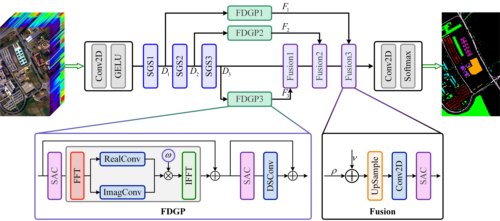
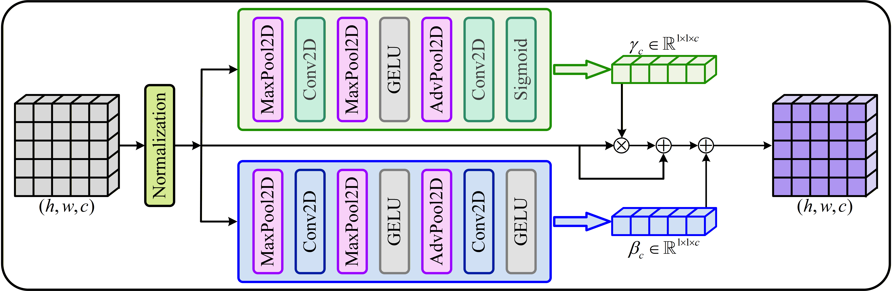

# <center><font color="#FFFFFF">S²Net: A Spatial Gradient Smoothing and Spectral Adaptive Correction Network for Robust Hyperspectral Image Classification Against Adversarial Attacks</font></center>

<div align="center">
  <h3>S²Net</h3>
  
</div>

<div align="center">
  <h3>SGS</h3>
  
</div>

<div align="center">
  <h3>SAC</h3>
  
</div>

# <center><font color="#FFFFFF">程序说明</font></center>

## (1)工具包[Utils](Utils)

- [KeyValuePairs.json](Utils%2FKeyValuePairs.json)文件保存了数据集的信息
- [SongTimes.ttf](Utils%2FSongTimes.ttf)是字体文件,中文是宋体,英文是Times New Roman,该文件来自于:https://www.wolai.com/matplotlib/uAZg7kK4j4b4CL3ffyoHfX
- [Utils.py](Utils%2FUtils.py)程序文件存储了大量的函数!!!!

## (2)[TrainModel.py](TrainModel.py)

通过设置以下9个变量的值更改程序训练结果

```python
data_index = 0  # 设置其数值,分别为:0⇒(PU)、1⇒(IP)、2⇒(SA)
model_name = "CeGCN"
is_save_attack_data = False  # 是否保存对抗样本以及噪声数据
is_save_weight_data = False  # 是否保存模型权重
is_save_json_data = False  # 是否覆盖之前的训练结果
number = 1  # 训练、攻击的次数
epsilon = 0.05  # 指定扰动幅度,用于在训练结束后打印对应扰动幅度的对抗样本测试结果
against_train_epsilon = 0.01  # 对抗训练的扰动幅度
against_train_epoch = 50  # 对抗训练的轮数
```

- 由于对抗样本会占用大量内存,故变量`is_save_attack_data`通常设置为`False`.
- `is_save_weight_data`变量用于控制是否保存本次训练生成的模型权重.由于模型权重文件通常会占用较大的存储空间,建议将其设置为`False`.若需要保存模型权重,可将`number`设置为`1`
  ,以避免重复训练时生成过多的权重文件.
- 若不希望本次训练覆盖之前保存的训练结果,请将变量`is_save_json_data`设置为`False`.
- `number`变量用于控制完整训练流程的重复次数,每次重复都会重新划分数据集并重新训练模型.
- `epsilon`
  用于指定扰动幅度,模型训练、攻击结束后,程序将输出该扰动幅度下各类攻击生成的对抗样本测试结果.因此应确保每种攻击对应的扰动幅度列表中均包含该值.相关参数可在[Config.py](Config.py)
  文件中通过`fgsm_epsilons`、`pgd_epsilons`和`cw_epsilons`变量进行设置.

## (3)[Config.py](Config.py)、[Requirements.py](Requirements.py) and [requirement.txt](requirement.txt)

- `Congig.py`该文件存储了大量常用的函数、变量
- `Requirements.py`引用导出环境中每个库的版本
- `requirement.txt`本项目所需的环境

## (4)[DataSet](DataSet)

`DataSet`文件夹用于存放实验所需的高光谱数据集及其对应的地面真实标签,目录结构如下:

```text
DataSet/
├── Indian_pines_corrected/
│   ├── Indian_pines_corrected.mat
│   └── Indian_pines_gt.mat
├── PaviaU/
│   ├── PaviaU.mat
│   └── PaviaU_gt.mat
└── Salinas_corrected/
    ├── Salinas_corrected.mat
    └── Salinas_gt.mat
```

## (5)[Experiment](Experiment)

- [Ablation2.py](Experiment%2FAblation2.py)程序用于分析`BatchNorm`对光谱分布偏移的放大效应,以及`SAC`模块对光谱分布偏移的抑制作用.
- [Ablation3.py](Experiment%2FAblation3.py)程序用于根据模型的权重文件生成对抗扰动,并对扰动进行频谱分析(计算其径向频谱曲线).
- [Fig8.py](Experiment%2FFig8.py)程序用于绘制不同模型在不同攻击扰动强度下的整体精度变化曲线.
- [Fig9.py](Experiment%2FFig9.py)程序用于绘制各模型干净样本与对抗样本的光谱均值对比曲线.
- `绘制假彩色和地面实况图像.py`根据高光谱图像数据绘制假彩色图像.
- `绘制对抗样本的地面实况图像.py`绘制不同攻击方法和扰动幅度下对抗样本预测结果对应的地面实况图像.
- `解析JSON文件结果.py`计算指定模型在指定数据集下的对抗样本测试结果.
- `计算模型效率.py`分析不同模型计算效率`flops、parameters`

## (6)[Models](Models)

```text
Models/
├── S2Net/
│   └── S2Net.py
├── OtherModel/
│   └── XXX.py
```

## (7)程序运行结果说明⇒[Result](Result)

- [AdversarialExamples](Result%2FAdversarialExamples)
  文件夹用于保存模型的对抗样本、对抗扰动(会占用大量内存!!!),在[MainTrain.py](TrainModel.py)中将变量<font color="green">is_save_attack_data</font>
  设置为 <font color="green">True</font> 便可进行保存。
- [FalseColor+GroundTruth](Result%2FFalseColor%2BGroundTruth)
  文件夹用于保存数据集的假彩色图像、地面实况图像,运行程序[绘制对抗样本的地面实况图像.py](Experiment%2F%BB%E6%D6%C6%B6%D4%BF%B9%D1%F9%B1%BE%B5%C4%B5%D8%C3%E6%CA%B5%BF%F6%CD%BC%CF%F1.py)
  即可生成相应的图片.
- [Fig8](Result%2FFig8)
  文件夹用于保存不同模型在不同攻击扰动强度下的整体精度变化曲线图,运行程序[Fig8.py](Experiment%2FFig8.py)可得到相应的结果图.
- [Fig9](Result%2FFig9)
  文件夹用于保存在指定数据集下,绘制各模型干净样本与对抗样本的光谱均值对比曲线图,运行程序[Fig9.py](Experiment%2FFig9.py)可得到相应的结果图.
- [Json](Result%2FJson)
  文件夹存储了模型的对抗样本测试结果,运行程序[解析JSON文件结果.py](Experiment%2F%BD%E2%CE%F6JSON%CE%C4%BC%FE%BD%E1%B9%FB.py)可以解析这些结果.
- [NoiseFrequencyAnalysis](Result%2FNoiseFrequencyAnalysis)
  文件夹存储了不同模型的对抗扰动的频域分析结果(径向频率曲线)
- [Weight](Result%2FWeight)
  文件夹存储了模型的训练权重
- [Log.log](Result%2FLog.log)文件用于存储模型训练、测试以及对抗攻击过程中的日志信息.

## (8)Acknowledgments

[SACNet](https://github.com/YonghaoXu/SACNet)&ensp;[WFCG](https://github.com/quanweiliu/WFCG)&ensp;[WFSS](https://github.com/edu-yinzhaoxia/WFSS)
&ensp;[S³ANet](https://github.com/YichuXu/S3ANet)&ensp;[RCCA](https://github.com/Hewq77/RCCA)&ensp;[CEGCN](https://github.com/qichaoliu/CNN_Enhanced_GCN)
## (9) Contact
如果您在使用本项目的过程中遇到任何问题,或有相关建议,欢迎通过以下邮箱与我们联系:
- 邮箱:[3208733169@qq.com](mailto:3208733169@qq.com)
